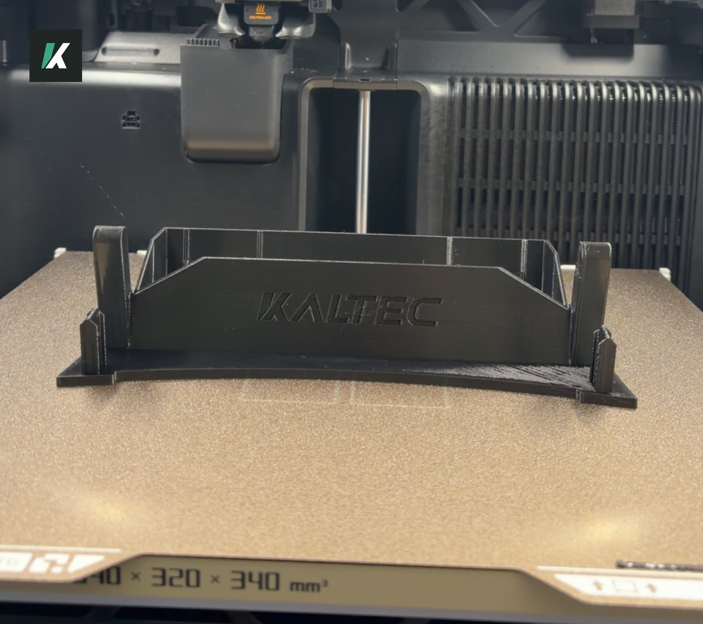

### Free 3D print files for all FG and FGX FALCONS. A bracket that replaces your tissue box and holds a single-DIN head unit, for a CarPlay or aftermarket stereo, all provided free by KALTEC.

**Jump to:** [Download](#download) · [Print settings](#print-settings)

---

IMAGE COMING SOON: the bracket in the car, no unit, next to picture of just the bracket side by side.

> [!TIP]
> Don't have a 3D printer? KALTEC brackets are coming soon, stick around! To preorder, email [kalteclabs@gmail.com](mailto:kalteclabs@gmail.com).

---

## DOWNLOAD
### The bracket replaces your tissue box (the tray in the dash). No screws: pull out the tray, pop in the bracket, and a single-DIN head unit takes its place.

Removing the tray and fitting the bracket is covered step by step in the [install guide](install-guide.md#1-take-out-the-tissue-box).

**[Spin the 3D preview](bracket/kaltec-fg-bracket-v1.0.stl)** to see it before you print.

| Download 3MF | |
| --- | --- |
| **GitHub** | [Download v1.0](https://github.com/kalteclabs/fg-falcon-carplay-unit/releases/latest/download/kaltec-fg-bracket-v1.0.3mf) |
| **Printables** | Coming soon |
| **MakerWorld** | Coming soon |

**Other files:** [Download STL](https://github.com/kalteclabs/fg-falcon-carplay-unit/releases/latest/download/kaltec-fg-bracket-v1.0.stl) · [Download STEP](https://github.com/kalteclabs/fg-falcon-carplay-unit/releases/latest/download/kaltec-fg-bracket-v1.0.step)

> [!TIP]
> Don't have a 3D printer? KALTEC brackets are coming soon, stick around! To preorder, email [kalteclabs@gmail.com](mailto:kalteclabs@gmail.com).

---

## PRINT SETTINGS

Tested on a Bambu Lab H2S with a 0.4 mm nozzle. Start from your printer's standard profile for the filament, then set these.

| Setting | PETG | ASA |
| --- | --- | --- |
| Orientation | Front face (the lip you see in the car) flat on the bed | Same |
| Supports | Off | Off |
| Layer height | 0.2 mm | 0.2 mm |
| Walls | 5 | 5 |
| Top / bottom layers | 5 / 5 | 5 / 5 |
| Infill | 40% gyroid | 40% gyroid |
| Nozzle temp | Profile + 10 °C (250–255 °C) | Your ASA profile |
| Part cooling fan | 30–40% | Your ASA profile's low setting |
| Print time | 2 h 56 min | N/A |
| Filament used | 85 g | N/A |

No supports needed: everything rises straight up or leans less than 45°, and the KALTEC lettering is recessed. The footprint is 225 × 95.8 mm, 58 mm tall. **Print it at 100% scale.** Scaling it changes the fit for the head unit and the clips.

---

## FILAMENT

Print in **PETG or ASA**.

| PETG | ASA |
| --- | --- |
| Cheaper, with more colour and finish options | More heat resistant, and resists warping |
| Prints on any printer | A better finish, closer to the factory dash plastic |
| More than enough if your car is tinted or parks in the shade | Ready to fit straight off the printer |

> [!WARNING]
> **Don't print it in PLA.** It softens in a hot car and the bracket sags.
> If your car sits in the sun or has no tint, use ASA, or give PETG a [UV clear coat](parts-list.md#optional).

IMAGE COMING SOON: PETG and ASA prints side by side.

---

## FITMENT
**picture of tabs on the bracket next to image of headunit in the bracket alone

Supports all FGs except the FPV line.

| Model | Sedan | Ute |
|---|:---:|:---:|
| XR6 | Y | Y |
| XR8 | Y | Y |
| G6E | Y | Y |
| G6 | Y | Y |
| XT | Y | Y |
| FPV | N | N |

**Too tight?** That's intended. Ensure the metal sleeve your unit came with is removed, then lightly sand the small ridges inside the 3D printed bracket, until the unit pushes in snug.

**Too loose?** Add thin inserts or tape inside the bracket. The unit should be tight, with no wiggle.

**Odd-sized head unit?** Open the STEP file and adjust the bracket to suit. The bracket design is free to build, change and sell under [CERN-OHL-S-2.0](LICENSE.md). If you share a changed version, credit KALTEC with a link to this repo and release it under the same licence.

Ready? Fit it with the [install guide](install-guide.md).

---

**KALTEC · CC BY-SA 4.0 · [github.com/kalteclabs/fg-falcon-carplay-unit](https://github.com/kalteclabs/fg-falcon-carplay-unit)**

This guide and its photos are free to share and adapt under CC BY-SA 4.0: credit KALTEC with a link to this repo. The bracket design is free to build, change and sell under CERN-OHL-S-2.0.

FG FALCON SINGLE-DIN Head Unit Free Bracket v1.1
